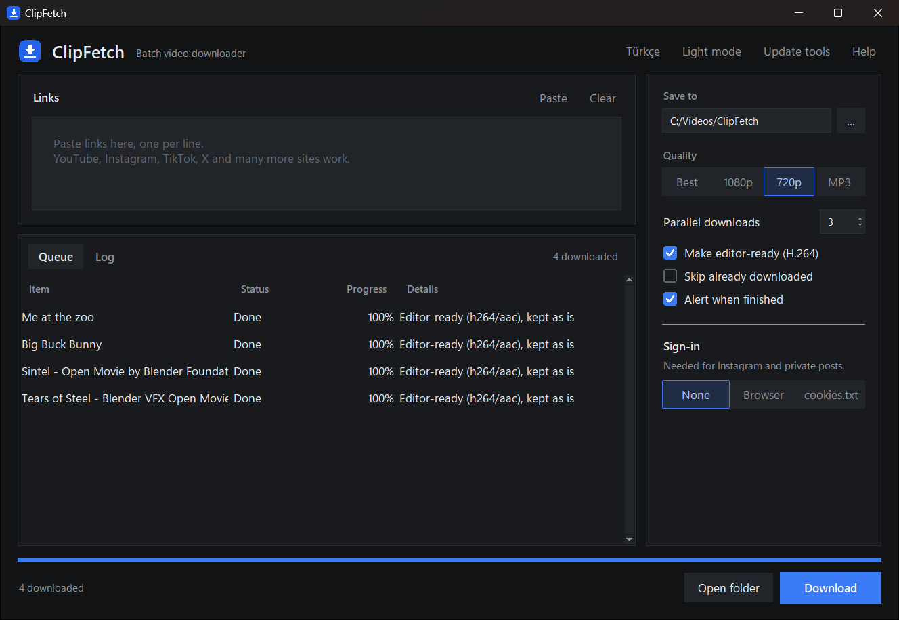
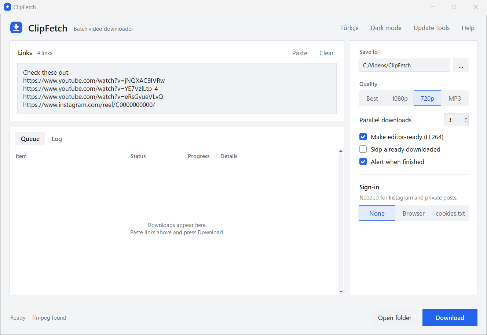

# ClipFetch

A Windows app and CLI for downloading videos in bulk with [yt-dlp](https://github.com/yt-dlp/yt-dlp).
Paste a batch of links and get every video in the highest quality available, saved in a video format
(H.264) that Premiere Pro and DaVinci Resolve open without errors.

**[Download ClipFetch.exe](https://github.com/hamzacakmakk/clipfetch/releases/latest)**: no Python or
setup needed.



Tested with YouTube, Instagram, TikTok, X, Facebook, Vimeo and Twitch, and works with the other sites yt-dlp
supports.

## Why

There are few good ways to download full-quality video from these platforms, and the files you do get are
often in a video format editing software can't use. Sites serve AV1 or VP9 video with Opus audio, or H.264
with a variable frame rate; Premiere either refuses those files or imports them as audio only.

ClipFetch downloads the highest resolution on offer, 4K included, and then checks the video format of every
finished file. Only when it has to, it converts the file to H.264 (High) / AAC / yuv420p at a constant
frame rate, the format every editor accepts. Files that are already in that format are not touched, so
there is no extra quality loss or waiting.

## Features

- **Paste anything.** Links are picked out of any text, one per line or mixed with other words, and
  duplicates are dropped.
- **A real queue.** Every link gets its own row with title, status, progress, speed and ETA, and a note on
  exactly what format change was made.
- **Parallel downloads**, 1 to 8 at a time, with one overall progress bar.
- **Cancel** a running batch, and **Retry failed** to rerun only the links that did not finish.
- Double-click a finished row to open the file. Right-click for *Show in folder*, *Copy link*, *Retry* and
  *Remove*.
- Quality presets: Best (up to 4K), 1080p, 720p, MP3.
- Video format conversion uses the GPU when it can (NVIDIA NVENC, Intel Quick Sync or AMD AMF) and falls
  back to the CPU.
- **Sign-in with cookies.txt** for Instagram and private posts, with a live check that the file actually
  contains an Instagram login.
- Clear error hints: locked or encrypted browser cookies, missing login, unreadable cookie files.
- Light and dark themes, English and Turkish, sharp on high-DPI screens.
- Keyboard: `Ctrl+Enter` start or cancel, `Ctrl+L` jump to the link box, `F1` help.
- One-click **Update tools** installs or refreshes yt-dlp and ffmpeg.
- A full CLI for scripts and terminals.
- Remembers every setting and the window size.



## Download

1. Get **ClipFetch.exe** from the [latest release](https://github.com/hamzacakmakk/clipfetch/releases/latest).
2. Put it in its own folder and double-click it. On first launch it downloads ffmpeg (about 80 MB) next to
   itself; settings are saved there too.

Windows SmartScreen may warn about an unrecognised app because the exe is not code-signed. Choose
*More info* > *Run anyway*.

## Run from source

Requires Windows 10 or 11 and [Python 3.9+](https://www.python.org/downloads/) (tick **Add Python to PATH**
during install).

```bat
git clone https://github.com/hamzacakmakk/clipfetch.git
cd clipfetch
setup.bat
start.bat
```

`setup.bat` installs yt-dlp and ffmpeg; `start.bat` opens the app without a console window. Or manually:

```bat
pip install -r requirements.txt
python clipfetch.py --setup
python clipfetch.py
```

To build the exe yourself: `pip install pyinstaller`, then run `build_exe.bat`. The result is
`dist\ClipFetch.exe`.

## Using the app

1. Paste links into the box, or press **Paste**.
2. Pick a folder and a quality.
3. For Instagram or private posts, set **Sign-in** to cookies.txt (see below).
4. Press **Download**.

**Make editor-ready (H.264)** is on by default. Turn it off to keep the original video format.

## Command line

```bat
ClipFetch.exe <link1> <link2> ...
python clipfetch.py <link1> <link2> ...
python clipfetch.py -f 1080 -o "C:/downloads" <link>
python clipfetch.py --audio <link>
python clipfetch.py --cookies cookies.txt <link>
python clipfetch.py --browser firefox <link>
python clipfetch.py --archive <link>
python clipfetch.py --no-fix <link>
python clipfetch.py --setup
```

| Option | Meaning |
| --- | --- |
| `-f, --format` | `best` (default), `1080`, `720`, `mp3` |
| `-o, --output` | output folder |
| `--audio` | audio only (MP3) |
| `--cookies` | path to a `cookies.txt` |
| `--browser` | read cookies from a browser (`chrome`, `firefox`, `edge`, ...) |
| `--archive` | skip videos that were already downloaded |
| `--no-fix` | keep the original video format, no H.264 conversion |
| `--setup` | install or update yt-dlp and ffmpeg (the exe carries its own yt-dlp; update it by downloading the latest release) |

Run with no arguments to open the app.

## Instagram and cookies

Instagram does not serve posts to logged-out visitors, so you need cookies. Chrome and Edge encrypt their
cookie store, which means reading cookies straight from the browser often fails. A `cookies.txt` file is the
reliable route:

1. Install the **Get cookies.txt LOCALLY** browser extension.
2. Log in at instagram.com.
3. With the instagram.com tab open, export `cookies.txt` from the extension.
4. In ClipFetch, set **Sign-in** to cookies.txt and choose the file. A green *Instagram login found* means
   you are ready.

`cookies.txt` contains your login session. Never share or commit it (it is in `.gitignore`).

## Notes

- YouTube only offers 1440p and 4K as AV1/VP9, so those downloads are always converted. Expect conversion to
  take roughly as long as the video plays on a laptop GPU, longer on the CPU. At 1080p and below an H.264
  version usually exists and is picked directly.
- Some sites only serve logged-in users: Reddit now always asks for an account, and some Instagram and Vimeo
  posts do too. Use a `cookies.txt` from a logged-in browser for those.
- yt-dlp is installed with `curl-cffi`, which lets it look like a regular browser. TikTok and others block
  plain requests without it.
- Settings are stored in `clipfetch_config.json` next to the script or the exe (git-ignored).
- Downloading with account cookies may break a site's terms of service. Use it responsibly.

## License

MIT, see [LICENSE](LICENSE). Built on [yt-dlp](https://github.com/yt-dlp/yt-dlp) and
[ffmpeg](https://ffmpeg.org/).
